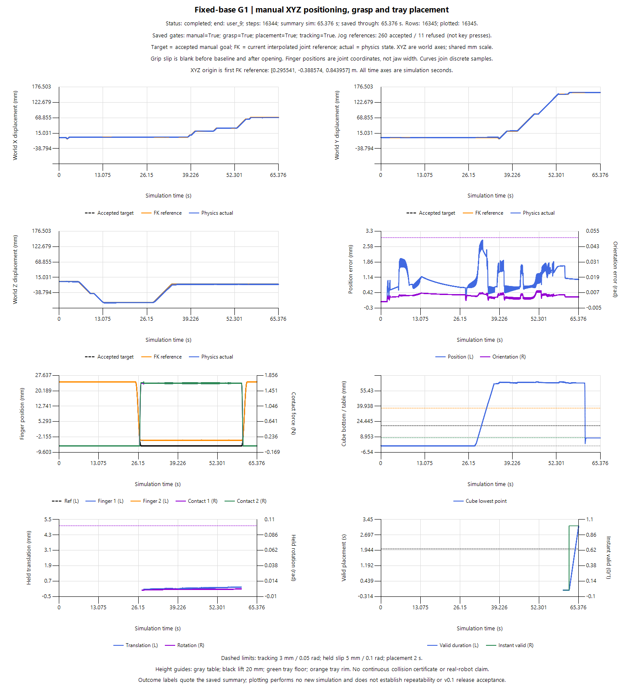
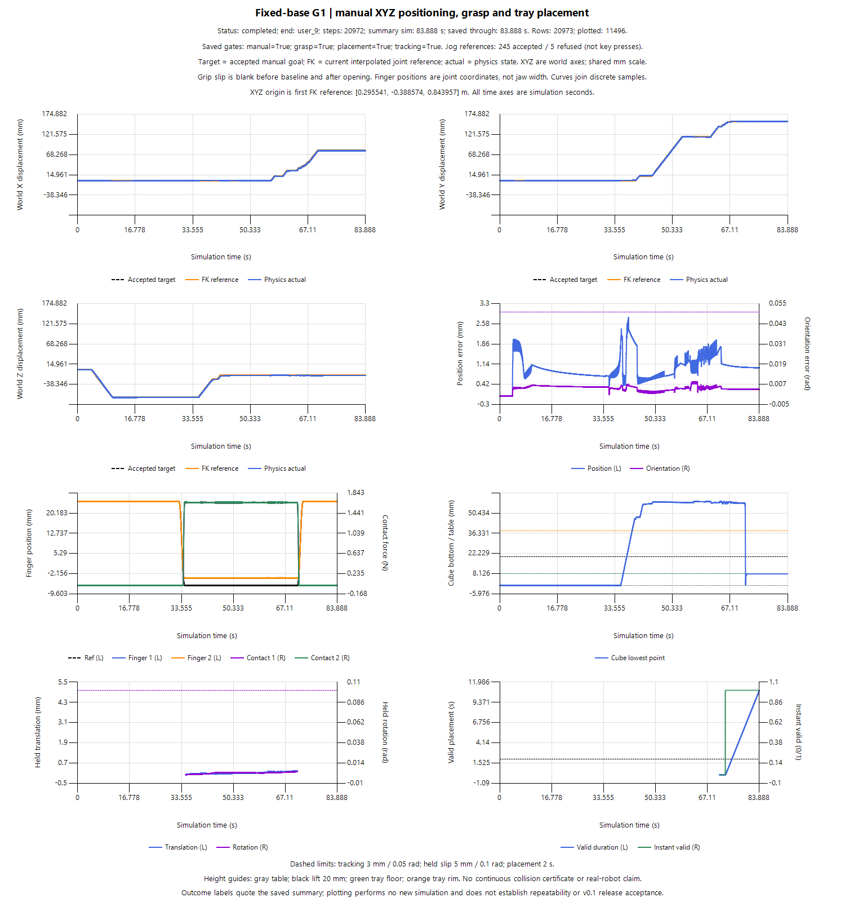
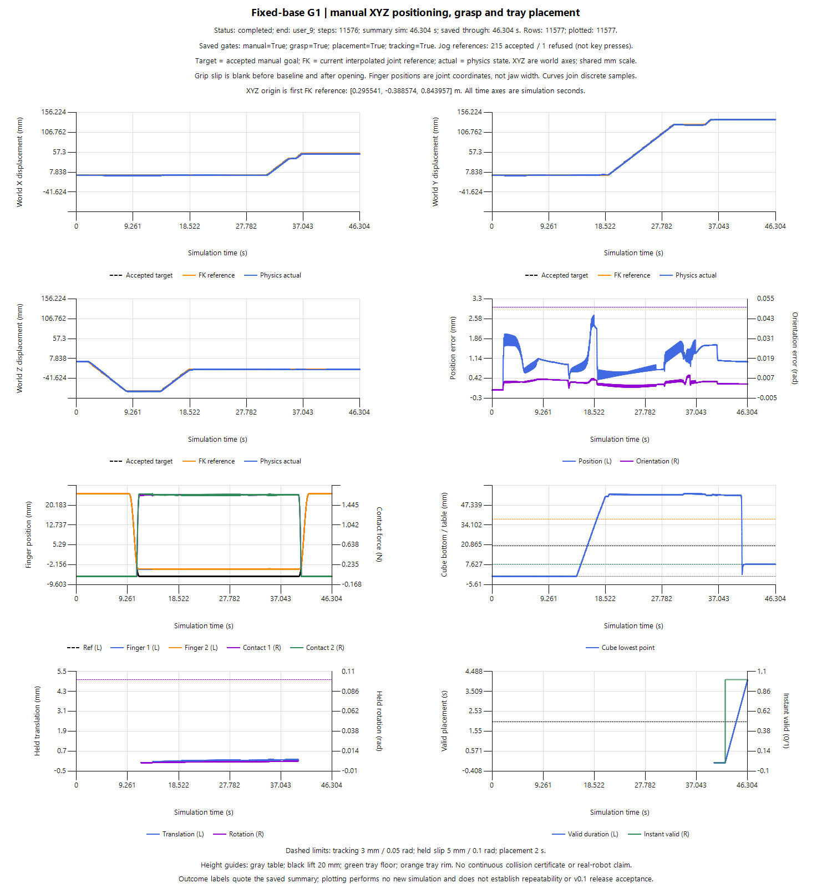

# 三次人工抓放复验结果

这些数据来自 2026-10-21 的三次用户实际运行，完整运行 ID 为 `manual_user_20261021_` 加下表的回合编号。原工程模型、初态及 24 项关键配置一致，84 项源码/资产快照哈希集合一致；每次重新启动，由用户自由操纵。

| 回合 | 仿真秒 | 循环现实秒 | 最大位置误差 / mm | 最大朝向误差 / rad | 持物最大滑移 / mm | 连续有效落盘 / s | 非预期接触计数最大值 |
|---|---:|---:|---:|---:|---:|---:|---:|
| 175535_099 | 65.376 | 87.791 | 2.887 | 0.008639 | 0.239 | 3.136 | 0 |
| 212238_372 | 83.888 | 104.780 | 2.810 | 0.008554 | 0.242 | 10.896 | 0 |
| 212557_670 | 46.304 | 62.865 | 2.709 | 0.008845 | 0.219 | 4.080 | 0 |

三次保存结果中的完整人工任务、抓取、运输、释放、落盘与跟踪字段均通过。逐行审核确认各回合末 2 秒的 501 个状态样本满足联合落盘条件。不同操作路线和等待时间会影响耗时，表中现实时间不是算法速度对照。

## 指标含义

- **跟踪误差**：实际工具点与当前插值关节参考的 FK 位姿之差，位置取模长；门槛为 3 mm 和 0.05 rad。它不是运动全过程相对最终目标的距离。
- **持物滑移**：相对实际双侧夹持后保存的夹持基线；建立基线前与主动松爪后不作零误差处理。
- **有效落盘**：已主动释放，整块在托盘内且边缘余量至少 2 mm；盘底支撑、夹爪脱离、速度及其他检查同时通过，要求连续 2 s。
- **接触检查**：保存样本中未记录非预期接触，不构成连续时间的碰撞证明。

所有曲线都是已有 PNG 的逐字节副本，没有平滑、重新仿真或修改失败记录。轻量展示不包含完整 CSV；下列哈希用于追溯原件身份，不能替代逐样本数据或独立复算。

## 三次曲线

### 回合 175535_099

### 回合 212238_372

### 回合 212557_670

## 来源与结论边界

原始运行摘要 `summary.json` 的 SHA-256：

| 回合 | SHA-256 |
|---|---|
| 175535_099 | `f3dc24b53bc022756136c6ede43da89bc0b2887514c2ad951c58d29974aaba72` |
| 212238_372 | `5bbe254764a634c9c904bd8bb80e5401b09e464c71b8b48589dc0c244efd0892` |
| 212557_670 | `93c951059f2b64cef94d399d507ab867aa95c347e0106bf62c62b9e4a56a537c` |

原始摘要中 `full_v01_accepted=false` 与 `learner_verified=false` 保留原样。它们与当次物理结果、后续三回合功能审核、学习掌握以及公开发布是不同判断层。

三回合验证的是同配置、同初态、不同人工路径的重启复验。独立候选入口随后由用户完成一次完整动力学抓放，最大位置误差2.890mm、连续有效落盘3.120s，见[候选入口验证](docs/candidate-user-verification.md)。这仍不证明任意布局泛化、自主抓放、学习策略或实机能力。完整录像尚未录制，v0.1.0 Release 尚未发布。

[返回项目首页](README.md)
