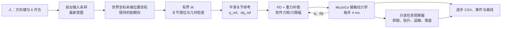

# 控制链与数据含义

v0.1 由人决定抓取位置、移动方向和释放时机。程序把方向输入转成末端目标，求关节参考，再以力矩驱动 MuJoCo 中的手臂与夹爪；方块的运动来自接触、摩擦与重力。

任务观察器给出评分和真实滑落/异常接触诊断。**“搬运通过”等评分标记不控制 6 键开合权限。** 关节、速度、几何检查仍会拒绝不合适的参考运动。

## 坐标与输入

世界坐标以米存储，曲线位移通常以毫米显示。+X 为机器人前方、+Y 为机器人左方、+Z 向上；相机转动不改变坐标。

| 输入 | 作用 |
|---|---|
| 7 | 从冻结初态开始本回合 |
| 按住 ↑ / ↓ | 世界 +X / −X |
| 按住 ← / → | 世界 +Y / −Y |
| 按住 PageUp / PageDown | 世界 +Z / −Z |
| 6 | 请求闭爪 / 开爪，任何任务阶段均可 |
| 8 | 切换相机 |
| 9 | 结束并保存，未完成也保存 |

方向输入只在本进程场景窗口处于前台时读取。同时按多个方向不移动；失焦停止续接，回到窗口需先松开方向键。松键后，已经执行的小段平滑走完，尚未提交的小段丢弃。6 的最新意图优先于新的方向段，在当前运动段结束后执行；连续按 6 会改变最新目标，不积压动作队列。

## 多速率与时间

| 环节 | 当前实现 | 解释 |
|---|---|---|
| 动力学、PD、状态记录 | Δt = 0.004 s，即 250 Hz 仿真频率 | 每个物理步重算反馈与力矩 |
| 短方向参考 | 最长 0.12 仿真秒，最多 1.5 mm | 30 次物理推进，含端点共 31 个参考样本 |
| 开合参考 | 2 仿真秒 | 最多 500 次推进，保持手臂参考位置 |
| 外层输入与显示 | 每批最多 4 个物理步后同步 | 名义约 62.5 Hz；现实频率受规划、记录与绘制影响 |
| IK 与参考检查 | 按需求执行，期间暂停物理推进 | 消耗现实时间，不增加仿真时间 |

短方向段的名义平均参考速度上限为 12.5 mm/仿真秒。1.5 mm 是参考余程上限，不能当成实际物理停止距离。`physics_loop_wall_s` 是物理循环开始后的现实耗时，包含规划与同步开销；它不是单独测得的求解器耗时。不同用户的等待和路线也不同，因此三回合耗时不是算法速度对照。

## 参考轨迹与反馈

`manual_task_target.py` 使用有界 IK 和回溯求解固定朝向下的局部位置目标。每次参考提交前，离散检查整个小段的关节限位、速度、姿态、环境和携物几何间隙。规划器使用独立的临时 `MjData`；这些检查不推进实际物理状态，也不构成连续碰撞证明。

`reachable_motion.py` 中的控制律为：

\[
u_{raw}=K_p(q_{ref}-q)+K_d(\dot q_{ref}-\dot q)+g(q),\qquad
u=\operatorname{clip}(u_{raw},-u_{max},u_{max}).
\]

重力项由独立数据副本在实际 q、零速度下计算，从而排除速度相关偏置。七个手臂关节以 rad、rad/s、N·m 表示；两个平移指关节以 m、m/s、N 表示。夹爪图中的数值是指关节坐标，不是总开口宽度。

| 项 | 七个手臂关节，然后两个指关节 |
|---|---|
| Kp | 120, 100, 80, 60, 40, 30, 30; 600, 600 |
| Kd | 8, 7, 5, 4, 2.5, 2, 2; 8, 8 |
| 软件力矩 / 力上限 | 12, 12, 10, 8, 6, 3, 3 N·m; 4, 4 N |

场景为固定基座 G1，MuJoCo 3.3.7，`implicitfast`、4 ms 步长、重力 −9.81 m/s²、`noslip_iterations=3`。完整冻结参数见 [公共配置](../evidence/common_configuration.json)。本版本没有腿部策略、视觉策略或学习控制器。

## 评分只观察实际结果

`manual_task_observer.py` 依据实际双侧接触建立夹持基线，并观察实际抬升、携物进入托盘区域和主动释放。再次闭爪会创建新尝试；主动开爪即结束该次夹持相对运动监测。空夹、提前松开、重新抓取都是允许的输入，本身不代表任务成功。

| 指标 | 当前门槛与含义 |
|---|---|
| 跟踪 | 实际工具点相对当前插值 FK 参考：位置 ≤ 3 mm、朝向 ≤ 0.05 rad |
| 稳定双侧接触 | 两指均有接触且法向力各 ≥ 0.3 N，满足相关条件连续 0.25 s 后建立基线 |
| 抬升 | 实际方块比夹持基线升高 ≥ 20 mm、底部离桌 ≥ 20 mm，且脱离支撑面 |
| 持物稳定统计 | 滑移 ≤ 5 mm、转角 ≤ 0.1 rad，并满足双侧接触、跟踪和低速，连续 2 s；不是继续移动或松爪的权限门槛 |
| 运输证据 | 在实际夹持、抬升后 XY 位移 ≥ 5 mm，整块进入托盘内，边界余量 ≥ 2 mm |
| 落盘 | 已主动释放；整块入盘且余量 ≥ 2 mm；盘底接触力 ≥ 0.1 N，底部间隙在 −1 至 2 mm；无桌面或盘壁接触；夹爪脱离；方块速度 ≤ 0.02 m/s、角速度 ≤ 0.2 rad/s；跟踪及异常接触条件通过，连续 2 s |

运行仍监测实际接触丢失、超限滑落、非预期接触和持续饱和。`noslip_iterations=3` 是接触求解参数，不是物体焊接；规划中的携物包络也不会绑定或重写实际方块位置。

## 曲线怎么读

- `Accepted target`：人最近提交的末端目标；`FK reference`：当前平滑关节参考的正运动学；`Physics actual`：物理状态中的工具点。运动中前两者暂时不同是正常的。
- 跟踪误差用实际状态减当前插值参考的位置范数，不能误读为相对最终目标的全程误差。
- 滑移、转角相对实际建立的夹持基线；建立前和主动松爪后为空值，不是零误差。
- CSV 逐物理步记录同一状态下的参考、实际状态与接触；末端行没有未来控制量。曲线连线连接保存样本，不补造物理轨迹。
